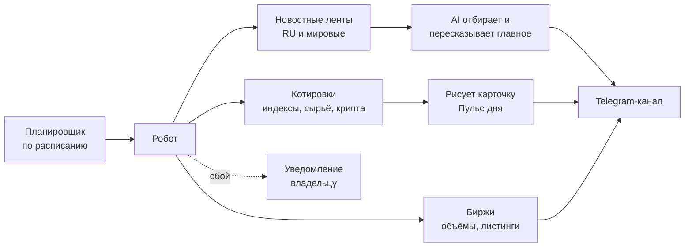

# Bull Run Yerevan — автоматический новостной канал

**Telegram-канал о рынках и крипте, который ведёт робот.**
Каждый день сам собирает данные, отбирает главное с помощью AI, рисует карточки и публикует посты — без участия человека.

> ⚠️ Это витрина проекта. Здесь показано, что делает робот и как он устроен.

📢 Канал: [t.me/bullrunyerevan](https://t.me/bullrunyerevan)

---

## Что публикует

| Рубрика | Когда | Что внутри |
|---|---|---|
| 📊 **Пульс дня** | каждое утро | Картинка-карточка: индексы США, Европы и Азии, золото, серебро, нефть, биткоин, эфир, Solana — с изменением за сутки |
| ₿ **Крипто-новости** | каждый день, днём | 5 главных новостей крипторынка из ведущих русских и мировых изданий, отобранных и пересказанных AI |
| 🌐 **Глобальные новости** | каждый день, вечером | Решения центробанков (ФРС, ЕЦБ, Банк Японии и др.) и крупные финансовые события |
| 🔥 **Аномальный объём** | по будням, перед открытием биржи США | Монеты с самым сильным ростом объёма торгов по сравнению с прошлым днём |
| 🚀 **Листинги** | сразу после анонса | Новые монеты на Binance и OKX — пост выходит в течение нескольких минут |

Посты разнесены по времени, чтобы не заваливать подписчиков уведомлениями.

## Как устроено

## Технологии

- **Python**
- **Claude AI** — отбор важных новостей, удаление повторов, короткий пересказ на русском
- Генерация картинок-карточек для постов
- Данные бирж и котировок через открытые API
- **Telegram Bot API** — публикация постов в канал
- Работает в облаке по расписанию, **без своего сервера** и почти без затрат
- Сам сообщает владельцу, если какой-то источник не ответил

## Скриншоты

_(скоро)_

---

## Нужен похожий робот для вашего канала?

Делаю автоматические каналы и ботов под ключ: сбор новостей, AI-обработка, картинки, публикация по расписанию.

📩 Связаться: [logo177@mail.ru](mailto:logo177@mail.ru)
